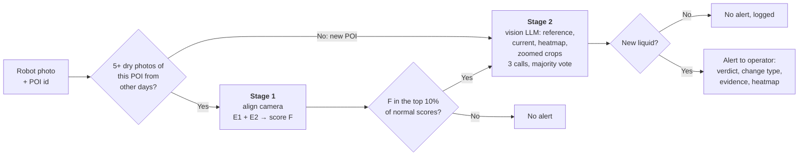

# Westlake Leak Detection — Two-Stage Experiments

Databricks notebooks for finding liquid leaks in plant inspection photos. An ANYbotics robot photographs the same points of interest (POIs) about twice a day, so detection works the way a person would: **first notice that a spot looks different from its own normal history, then decide what the change actually is.**

**Current result (v2, Oct 26, 2026):** on the 156 available labeled images (6 leaks, 150 normal), the v2 pipeline (stage 1 **Model F** + stage 2 **Claude Sonnet 5.5**) catches **6 of 6 leaks with 2 false alarms** (precision 0.75, F1 0.86). With **Gemini 3.8 Flash** as the second check it catches **6 of 6 with 3 false alarms** (F1 0.80).

| System | Leaks caught | False alarms | Precision | F1 |
|---|---|---|---|---|
| Current production model (`leak_suspected`) | 3/6 | 49 | 0.06 | 0.10 |
| v1: Model D + Gemini 3.8 Flash | 5/6 | 0 | 1.00 | 0.91 |
| **v2: Model F + Claude Sonnet 5.5** | **6/6** | **2** | **0.75** | **0.86** |
| v2: Model F + Gemini 3.8 Flash | 6/6 | 3 | 0.67 | 0.80 |

v1 missed the small puddle at POI 422. v2 catches it, at the cost of 2–3 false alarms. See [Caveats](#caveats) before quoting these numbers: there are only 6 leak images (about 4 leak events).

**Contents**
- [How the v2 pipeline works](#how-the-v2-pipeline-works): the decision tree, then each step in detail
- [v2 results](#v2-results): stage 1, stage 2, remaining false alarms, caveats
- [Running the notebooks](#running-the-notebooks)
- [v1 experiments](#v1-stage-1-change-detection-oct-18-2026): the earlier models (A–D) and LLM comparison, kept for history

> [!IMPORTANT]
> **Update these names before running in Westlake's environment.**
> Every catalog, schema, table, volume, model and endpoint name in these notebooks points at the Databricks FE demo workspace (`stable_classic_wg38i9_catalog`). Westlake's workspace will use **different names**, and the notebooks will fail on the first data cell until you change them.
>
> | What | Variable / location | Notebook(s) | Current (demo) value | Change to |
> |------|---------------------|-------------|----------------------|-----------|
> | MLflow experiment | `EXPERIMENT` (cell *Setup and Data Loading*) | all | `/Users/jeffrey.pao@databricks.com/Leak Detection - POI Baseline Experiments` | A workspace path you own |
> | Labeled source table | `SPLITS_TABLE` (cell *Setup and Data Loading*) | all | `stable_classic_wg38i9_catalog.westlake_gas_leakage_2.silver_liquid_leak_results_splits` | Westlake labeled results table |
> | Image volume folder | `IMAGE_BASE_PATH` (cell *Setup and Data Loading*) | all | `/Volumes/stable_classic_wg38i9_catalog/westlake_gas_leakage_2/documents/OneDrive_1_10-13-2026/` | Westlake volume + folder |
> | v2 cache folder | `CACHE` (cell *Setup and Data Loading*) | both v2 | `/Volumes/stable_classic_wg38i9_catalog/westlake_gas_leakage_2/documents/experiments_cache/stage1_v2/` | A writable volume folder (must match in both v2 notebooks) |
> | Registered model | `MODEL_NAME` (cell *Define Model D Pyfunc, Log and Register as Champion*) | v1 stage 1 | `stable_classic_wg38i9_catalog.westlake_gas_leakage_2.leak_detection_model` | `<westlake_catalog>.<westlake_schema>.<model_name>` |
> | LLM serving endpoints | `LLMS` widget | v2 stage 2 | `databricks-gemini-3-8-flash`, `databricks-claude-sonnet-5-5` | Endpoints available in Westlake's workspace |
> | LLM serving endpoints | `LLMS` list (cell *LLM Client and Response Parsing*) | v1 stage 2 | `databricks-gemini-3-8-flash`, `databricks-claude-sonnet-5-5`, `databricks-claude-opus-4-7`, `databricks-gpt-6-1-sol` | Endpoints available in Westlake's workspace |
>
> The source table must also have the columns listed in [Input data](#input-data).

## Files

| File | What it is |
|------|------------|
| `notebooks/stage1_v2_aligned_experiments.py` | **v2 stage 1.** Camera alignment, E1 (same-spot comparison), E2 (new dark patch), ensemble F, plus the v1 baselines recomputed for comparison. Caches embeddings, scores and maps for stage 2 v2. |
| `notebooks/stage2_v2_llm_verification.py` | **v2 stage 2.** LLM verification of F's alerts with zoomed, camera-aligned hotspot crops and a 3-call majority vote. |
| `notebooks/poi_baseline_experiments.py` | v1 stage 1 (Models A–D), Databricks source format |
| `notebooks/poi_baseline_experiments.ipynb` | v1 stage 1 in Jupyter format **with outputs** from the Oct 18, 2026 run, viewable on GitHub |
| `notebooks/stage2_llm_verification.py` | v1 stage 2 (Model D + four LLMs) |

These are exports of the workspace notebooks in `/Users/jeffrey.pao@databricks.com/` (`Leak Detection - Stage 1 v2 Aligned Experiments`, `Leak Detection - Stage 2 v2 LLM Verification`, `Leak Detection - POI Baseline Experiments (notebook)`, `Leak Detection - Stage 2 LLM Verification (notebook)`). All four log to the same MLflow experiment.

# How the v2 pipeline works

## The decision tree

Every robot photo goes through the same steps:

Stage 1 is plain Python with no AI judgment. It only asks *"is this spot different from its usual self?"* and is tuned to miss nothing. Stage 2 is the only step that uses an LLM. It asks *"is that difference new liquid, or something else?"* and can only remove alerts, never add them. So stage 2's recall is capped by stage 1's.

## Step 0: pick the comparison photos

For a new photo, the reference set is every photo of the **same POI**, taken on a **different day**, that a human labeled as **no leak**.

- Photos from the same day are excluded. Three of the six leak photos are the same puddle at POI 412 photographed within a few hours, and they must never vouch for each other.
- If a POI has **fewer than 5** such photos (POIs 358, 398, 399 and 400 in this data), there is no history to compare against. Those photos skip stage 1 and go straight to stage 2, where the LLM judges the photo on its own. v1 handled these by comparing against *all* POIs, which flagged them by accident rather than by design.

## Step 1: line up the camera

The robot never stops in exactly the same place, so photos of the same spot are shifted. Measured shifts at 960×540: **median 12 px, 90th percentile 24 px, max 49 px** (roughly 4× that in the 4K originals). Without alignment, every edge in the frame looks like a change.

Alignment is a short NumPy function (`phase_shift`), with no LLM and no special library:

1. Downscale both photos to 960×540 grayscale lightness (CIE L\*).
2. Apply a Hann window so the photo borders don't count as features.
3. **Phase correlation:** take both 2-D FFTs, compute the normalized cross-power spectrum, and inverse-FFT it. A pure shift between the photos becomes a single sharp peak, and the peak's position is the shift `(dy, dx)`.
4. Repeat for every ordered pair of photos of the same POI (2,480 pairs, about 20 ms each).

A synthetic test (shift a photo by a known `(7, −12)` and recover it) runs on every notebook run to check the sign convention.

Phase correlation only corrects **translation**. Small rotation, tilt or zoom changes are absorbed by tolerance built into E1 (a ±2-patch search window) and E2 (a 5×5 "darkest nearby pixel" rule), and by per-location normalization (step 2c). A full perspective correction (for example, OpenCV ORB/SIFT keypoints + RANSAC homography) is a possible upgrade if larger viewpoint changes show up.

## Step 2: E1, same-spot comparison ("does this spot look different from its usual self?")

E1 is an aligned, location-normalized version of PatchCore.

**a. Describe every small square of the photo.** DINOv2-small (a pretrained, self-supervised vision transformer from Meta, not fine-tuned) turns each 14×14-pixel patch into a 384-number descriptor. The photo is resized to 896×1596 and processed as **2×2 tiles of 448 px**, giving a **64×114 patch grid**, twice the resolution of v1. A puddle that covered about 5 patches in v1 now covers about 20.

**b. Compare each patch only with the same location.** For patch *(r, c)* in the current photo, find its nearest neighbor among the reference photos' patches **within ±2 patches of the aligned location** *(r + dy, c + dx)*. Distance is Euclidean distance between the normalized descriptors. Taking the minimum over all reference photos gives a **distance map**: how unlike any dry photo each part of the current photo is.

v1 (PatchCore-lite) let a patch match *any* patch anywhere in the reference bank, so a wet floor patch could find a close match in some other dark region of the scene.

**c. Normalize each location by how much it normally varies.** Some places differ every day even when dry: windows, lights, reflections, moving shadows. For each reference photo, compute its own distance map against the *other* reference photos (leave one out, other days only). Then, at every location:

- `mu` = median of those leave-one-out distances
- `sd` = 1.4826 × MAD, smoothed with a Gaussian (σ = 1 patch) and floored at half its median
- **z = (distance − mu) / sd**

A large z means "unusual *for this spot*".

**d. Score.** The E1 score is the **mean of the top 0.1% of z values** (about 7 patches). v1 averaged the top 1% (about 18), which let ordinary background patches outvote a small puddle.

## Step 3: E2, new dark patch ("is part of the floor newly darker?")

Wet concrete is darker than dry concrete. E2 checks that directly, at pixel level:

1. Shift each reference photo's L\* lightness image (960×540) by its alignment, and take the per-pixel **median** and **MAD** across the references.
2. Remove the global lighting change: subtract the median difference between the current photo and the reference median over the whole frame.
3. Compare each pixel with the **darkest reference pixel in its 5×5 neighborhood**, so a slightly shifted dark edge (a pipe, a shadow) isn't counted as darker.
4. A pixel is "newly dark" if it is at least **8 L\* units darker** *and* at least **3 robust SDs** of that pixel's day-to-day variation (noise floor 2 L\*).
5. Clean up specks with a binary opening (2 iterations). The E2 score is the **area of the largest connected dark blob**, as a fraction of the frame.

## Step 4: combine into F

E1 and E2 measure different things (texture/appearance vs. darkening) and make different mistakes. **F = average of the percentile ranks of E1 and E2.** A photo needs to look unusual to both to rank highly.

## Step 5: decide what goes to stage 2

The alert threshold is the **90th percentile of F over normal (no-leak) photos only** (the "10% budget"). Leak labels are never used to set it. In this data, that sends **21 of 156 photos** to stage 2, including all 6 leaks. A 20% budget (36 photos) gave the same final result at about 70% more LLM calls.

## Step 6: build what the LLM sees

For each stage 2 candidate (`stage2_v2_llm_verification.py`):

| Image | What it is |
|---|---|
| 1. Reference | The dry photo of the same POI from another day that is most similar overall (DINOv2 CLS embedding cosine similarity) |
| 2. Current | The photo that triggered the alert |
| 3. Heatmap | The current photo with the E1 z-map overlaid (red/yellow = most changed) |
| 4–7. Zoomed pairs | Up to two **reference/current crop pairs** (1280×720 from the 4K originals, camera-aligned with the step 1 shift), centered on the E1 peak and on the largest E2 dark blob |

All images are downscaled to at most 1024 px wide and sent as JPEG.

The zoomed pairs matter for small leaks. For the POI 422 puddle, both LLMs cited "Zoom 2" as where they saw it. For POIs with no history, the LLM gets only the current photo and a "new inspection point, judge it on its own" prompt.

## Step 7: ask the LLM, three times

The prompt lists liquid-leak indicators that must be **new compared with the reference**:
- a wet or glossy patch
- pooling, drips or a flow path
- a sharp wet/dry boundary
- wetness below a flange or valve
- small puddles, which still count

It also lists common false-alarm causes:
- new or moved objects
- lighting, reflections and shadows
- camera angle
- old stains or markings also visible in the reference
- dirt and footprints

The model must answer with JSON: `leak`, `change_type`, `confidence`, `evidence`. The exact prompts are logged to MLflow as `prompts.json`.

**Why three calls with the same prompt:** LLM outputs aren't deterministic (the endpoint's default sampling is used), so the same request can flip on a borderline image. The candidate's verdict is the **majority of 3 identical calls**, and the agreement rate is logged per image. In this run every real leak got 3/3 "leak" votes from both LLMs. Gemini's single-call false alarms ranged 2–3 and Sonnet's were 2 (at 10%), so voting mostly makes results repeatable rather than changing them. **Fail-safe:** if a call errors after retries, it counts as a "leak" vote, so an outage never silently drops an alert.

Calls go through Databricks Foundation Model APIs with the OpenAI-compatible client (`/serving-endpoints`), 8 in parallel.

## Step 8: output

A confirmed alert carries the majority verdict, `change_type`, `confidence`, a one-line `evidence` string (for example *"new dark glossy puddle near the red pipe, absent in the reference"*) and the heatmap, ready for operator review.

## How it was tested

Same strict protocol as v1:
- all 156 labeled photos with an image file (6 leaks, 150 normal, 13 POIs, 12 days)
- **leave-one-day-out** (a photo is scored only against photos from other days)
- thresholds from normal-photo percentiles only
- leak labels used only to grade the final result

# v2 results

## Stage 1 v2 (Oct 26, 2026)

| Model | ROC-AUC | PR-AUC | FP to catch 6/6 | Caught @10% (15 FP) | Caught @20% (30 FP) | Leak ranks (of 156) |
|---|---|---|---|---|---|---|
| D (v1 champion, recomputed) | 0.840 | 0.180 | 88 | 4/6 | 5/6 | 8, 9, 15, 16, 23, 94 |
| E1-448 (aligned, v1 resolution) | 0.816 | 0.138 | 53 | 1/6 | 4/6 | 3, 18, 22, 29, 56, 59 |
| E1-896 raw (no per-location normalization) | 0.896 | 0.192 | 33 | 4/6 | 5/6 | 3, 15, 18, 19, 21, 39 |
| E1-896 | 0.916 | 0.213 | 19 | 4/6 | 6/6 | 3, 13, 16, 18, 22, 25 |
| E2 | 0.929 | 0.239 | 16 | 4/6 | 6/6 | 3, 12, 13, 15, 20, 22 |
| **F. E1-896 + E2** | **0.955** | **0.307** | **9** | **6/6** | **6/6** | **3, 9, 11, 12, 13, 14** |
| G. B1 + C2 + E1-896 + E2 | 0.932 | 0.296 | 34 | 5/6 | 5/6 | 3, 7, 8, 12, 13, 40 |

- **The POI 422 leak moved from rank 94 (D) to rank 13 (F).** In the heatmaps, both E1 and E2 peak on the puddle itself.
- **Each design choice helps.** The ablations show that alignment alone at v1 resolution (E1-448) is not enough, 2× resolution helps, and per-location normalization helps further (E1-896 raw vs. E1-896).
- **E1 and E2 are complementary.** Each catches 6/6 on its own at the 20% budget, and they rank different photos highly, which is why F beats both.
- **Adding the v1 models back in (G) makes it worse.** Their whole-image statistics pull the POI 422 leak back down to rank 40.

## Stage 2 v2 (Oct 26, 2026)

| System | Budget | Leaks caught | False alarms | Precision | F1 | LLM calls | p50 latency |
|---|---|---|---|---|---|---|---|
| Stage 1 only (F) | 10% | 6/6 | 15 | 0.29 | 0.44 | 0 | — |
| Stage 1 only (F) | 20% | 6/6 | 30 | 0.17 | 0.29 | 0 | — |
| **F + Claude Sonnet 5.5** | **10%** | **6/6** | **2** | **0.75** | **0.86** | 63 (21 × 3) | 3.1 s |
| F + Claude Sonnet 5.5 | 20% | 6/6 | 2 | 0.75 | 0.86 | 108 (36 × 3) | 3.1 s |
| F + Gemini 3.8 Flash | 10% | 6/6 | 3 | 0.67 | 0.80 | 63 (21 × 3) | 2.8 s |
| F + Gemini 3.8 Flash | 20% | 6/6 | 3 | 0.67 | 0.80 | 108 (36 × 3) | 2.8 s |

Latency is per call, measured with 8 calls in parallel.

**Recommended configuration:** F + Claude Sonnet 5.5 at the 10% budget. It ties for 100% recall, has the fewest false alarms, and uses about 40% fewer calls than the 20% budget for the same result. Gemini 3.8 Flash is a close alternative: a 1-alarm gap out of 150 normal photos is within run-to-run noise.

## Remaining false alarms

| Photo | Flagged by | What it is | Likely fix |
|---|---|---|---|
| POI 412, 2026-09-11 | Both LLMs | A **dried residue ring** where the 09-08 puddle had been. The most-similar reference was from before the leak (09-08 04:01), so the stain looked new. | Also send the **most recent** dry photo as a second reference; it would already show the stain. |
| POI 417, 2026-09-08 | Sonnet | A dark area on the floor next to a hose that had been moved | Review with Westlake operators; more labeled history at this spot |
| POIs 398 and 400 | Gemini | New POIs with no history, judged from a single photo | Resolves as the robot builds 5+ dry photos of each POI |

## Caveats

- **Very few leaks:** there are only 6 leak photos from about 4 leak events. One photo changes recall by 17 points.
- **Possible design bias:** E1 and E2 were designed after studying the leak v1 missed. The ablations and the fact that E1 and E2 each reach 6/6 independently argue against a lucky fit, but they don't rule it out.
- **The LLM comparison is close:** the Sonnet vs. Gemini comparison rests on a 1-photo difference, and in v1 Gemini was the stronger verifier.
- **Treat these as promising, not final:** confirm them on new labeled robot photos before production.

## MLflow runs (demo workspace)

Experiment: `/Users/jeffrey.pao@databricks.com/Leak Detection - POI Baseline Experiments`

| Run | Run ID |
|---|---|
| Summary - Stage 1 v2 aligned experiments | `83565260569d4f878f13ad18508193ca` |
| v2 F. Ensemble E1-896 + E2 | `89840de3ae4141ff85de63f558882746` |
| **Stage 2 v2: F + Claude Sonnet 5.5 [10% budget]** | `d909479ea59b46159090fdd3dc11808d` |
| Stage 2 v2: F + Gemini 3.8 Flash [10% budget] | `c07ab3163d0545d68397e255989fd487` |
| Summary - Stage 2 v2 LLM verification (F) | `dde458cd8c8e40ffbc67f12a75c58fe4` |

Artifacts:
- The stage 1 summary run logs `summary.json`, `per_leak_ranks.json` and `v2_heatmaps.png` (reference / E1 heatmap / E2 dark blob for every leak and the top false alarms).
- Each stage 2 run logs `candidate_verdicts.json` (votes, agreement, change type, evidence per candidate) and `prompts.json`.

The F model is **not yet registered** in Unity Catalog; `leak_detection_model` v3 (Model D) still holds the `Champion` alias. Packaging F as an MLflow pyfunc is the main open step. It would store each POI's reference descriptors and per-location `mu`/`sd` maps, so a new photo is scored without recomputing every pair.

# Running the notebooks

1. Import the notebooks from `notebooks/` into a Databricks workspace.
2. Update the names in the table at the top of this README.
3. Use serverless or a cluster with internet access, so it can download `facebook/dinov2-small` from Hugging Face. The v2 notebooks were run as serverless jobs (environment version 4).
4. **v2 stage 1** (`stage1_v2_aligned_experiments.py`): run all cells.
   - The first run computes features and embeddings for every photo (about 21 minutes on serverless CPU, about 25 minutes end to end) and caches them in `CACHE`. Later runs reuse the cache and take a few minutes.
   - It also writes the scores, E1 z-maps, E2 masks and camera shifts that stage 2 v2 needs.
5. **v2 stage 2** (`stage2_v2_llm_verification.py`): run all cells after stage 1 v2. Widgets:
   - `STAGE1_MODEL`: which stage 1 score to use (default `F. Ensemble E1-896 + E2`)
   - `LLMS`: comma-separated `Name=endpoint` pairs
   - `REPEATS`: calls per candidate (default 3)

   It checks that the stage 1 cache matches the current image list and stops if it's stale.
6. **v1 notebooks:** see the v1 sections below. v1 stage 1 ends with `dbutils.notebook.exit()` before its model registration cells, and v1 stage 2 recomputes Model D itself.

# v1 stage 1: change detection (Oct 18, 2026)

## Models compared

| Model | Idea | Needs leak examples to train? |
|---|---|---|
| Current production model | `leak_suspected` column from the table | — |
| A. Absolute features + LR | 10 hand-crafted image features, logistic regression (prior best approach) | Yes |
| B1. POI-relative feature anomaly | RMS of robust z-scores vs. this POI's normal images | **No** |
| B2. POI-relative features + LR | Logistic regression on the POI-relative z-scores | Yes |
| C1. DINOv2 global kNN | 1 − cosine similarity of the DINOv2 CLS embedding to the nearest normal image of the same POI | **No** |
| C2. DINOv2 PatchCore-lite | Patch-level nearest-neighbor distance to the POI's normal patch bank (also shows *where* the change is) | **No** |
| D. Ensemble B1 + C2 | Average percentile rank of B1 and C2 | **No** |

### Evaluation protocol

- 156 images with a matching file in the volume: 6 leaks, 150 normal, 13 POIs, 12 days.
- **Leave-one-day-out**: each image is scored using only images from *other days*, so images of the same leak event never inform each other.
- POI reference = labeled-normal images of the same POI from other days (minimum 5). If there are fewer, it falls back to normal images from all POIs (4 images, at POIs 358, 398, 399 and 400).
- Primary metrics: **false alarms needed to catch k of 6 leaks**, and leaks caught under a fixed false-alarm budget (5% / 10% of normal images). Budget thresholds come from normal-image score percentiles only. No thresholds are tuned on leak images.

## Results (last run, Oct 18, 2026)

| Model | ROC-AUC | PR-AUC | FP to catch 6/6 | FP to catch 4/6 | Caught @ 5% budget | Caught @ 10% budget |
|---|---|---|---|---|---|---|
| Current production model | — | — | — | — | 3/6 (49 FP, binary alert) | 3/6 (49 FP, binary alert) |
| A. Absolute features + LR | 0.374 | 0.072 | 149 | 147 | 1/6 (8 FP) | 1/6 (15 FP) |
| B1. POI-relative feature anomaly | 0.799 | 0.163 | 106 | 22 | 1/6 (8 FP) | 3/6 (15 FP) |
| B2. POI-relative features + LR | 0.310 | 0.049 | 148 | 148 | 0/6 (8 FP) | 1/6 (15 FP) |
| C1. DINOv2 global kNN | 0.646 | 0.105 | 132 | 34 | 1/6 (8 FP) | 2/6 (15 FP) |
| C2. DINOv2 PatchCore-lite | **0.853** | 0.165 | **68** | 16 | 1/6 (8 FP) | 3/6 (15 FP) |
| **D. Ensemble B1 + C2** | 0.840 | **0.180** | 89 | **12** | **2/6 (8 FP)** | **4/6 (15 FP)** |

**Takeaways**
- Comparing against each POI's own history works much better than absolute features. A and B2 (the supervised models) do worse than random with only 6 leaks to learn from.
- Model D catches 4 of 6 leaks with 15 false alarms. The current production model catches 3 of 6 with 49.
- The best models are fully unsupervised, so they don't depend on collecting more leak examples.

## Notebook walkthrough

| Cell | What it does |
|------|--------------|
| Install Dependencies | `mlflow scikit-learn scipy matplotlib pillow torch torchvision transformers` |
| Setup and Data Loading | Loads the labeled table, keeps rows whose image exists in the volume, and derives `day`, `poi`, `y` and `current_alert` |
| Reference Selection and Evaluation Helpers | `reference_idx()` (same-POI normals with fallback), `evaluate()`, and `log_model()` (logs to MLflow) |
| Current Production Model Baseline | Scores the existing `leak_suspected` alert |
| Feature Extraction | 10 features from the bottom 60% (floor area) of each image |
| POI-Relative Feature Transform | Robust z-scores (median / MAD) vs. the POI's normal reference |
| A, B1, B2 | Feature-based models |
| DINOv2 Embeddings | `facebook/dinov2-small` CLS and patch tokens at ~448px |
| C1, C2 | Embedding-based models. C2 also saves `patchcore_heatmaps.png` as an MLflow artifact |
| D | Rank-average ensemble of B1 + C2 |
| Comparison Summary | Side-by-side table, alerts per POI, and a summary MLflow run. **Ends with `dbutils.notebook.exit(...)`** |
| Prepare Reference Artifacts for Model D | Pickles the per-POI normal features / embeddings / patches, C2 medians, historical scores, config, and DINOv2 weights |
| Define Model D Pyfunc, Log and Register as Champion | `LeakDetectionEnsemble` MLflow pyfunc. Registers it to UC and sets the `Champion` alias |

> [!NOTE]
> The *Comparison Summary* cell calls `dbutils.notebook.exit()`, so **Run all** (or a job run) stops there and the last two registration cells don't run. To register Model D, run those two cells manually after the summary, as was done for the Oct 18 run.

## Input data

The source table (`SPLITS_TABLE`) needs these columns:

| Column | Used for |
|--------|----------|
| `filename` | Matched against files in `IMAGE_BASE_PATH` |
| `point_of_interest_id` | POI grouping (cast to `int`) |
| `created_on_date_time` | Day used for leave-one-day-out splits |
| `leaked` | Ground truth (`1.0` = leak) |
| `leak_suspected` | Current production alert (`"Yes"` / other) |
| `split` | Shown in the leak preview table |

## Registered model (Model D)

- **Input:** DataFrame with `image_path` (str) and `poi_id` (int)
- **Output:** `anomaly_score` (0–1, average percentile rank), `b1_score`, `c2_score`, `b1_rank`, `c2_rank`
- POIs with fewer than 5 normal reference images fall back to the pooled reference from all POIs.

In the demo workspace, this notebook produced **v2** of `leak_detection_model` (MLflow run `db63beefecbf48ca8eabaedfef3285a0`). That version has since been **superseded by v3** (run `f2cc26eac4fe4b1293c15e54eb13a8fe`), which was built from v2's artifacts by a separate notebook, `Leak Detection - Register Model D v3`, and now holds the `Champion` alias.

# v1 stage 2: AI verification (Oct 16, 2026)

Stage 1 is tuned to catch as many leaks as possible, which means it also produces false alarms (new objects, lighting changes, camera shifts). Stage 2 sends each stage 1 alert to a vision LLM to remove them. **Stage 2 can only remove alerts, so its recall is capped by stage 1.**

### How it works

1. **Stage 1 candidates:** the notebook recomputes Model D exactly as in the baseline notebook. Candidate sets come from normal-image score percentiles only (no tuning on leaks):
   - **10% budget:** the threshold where 10% of normal images alert (stage 1: 4/6 leaks, 15 false alarms)
   - **20% budget:** a wider net, so stage 2 has a chance to keep 5/6 leaks (stage 1: 5/6 leaks, 31 false alarms)
2. **Reference image:** the most similar known-dry image of the same POI from a *different day*, chosen by DINOv2 CLS similarity. POIs with no history get no reference.
3. **What the LLM sees:** the reference image, the current image, and the current image with the stage 1 change heatmap overlaid. Without a reference, it sees only the current image and the heatmap.
4. **Prompt:** lists liquid leak indicators (a new wet or glossy patch, pooling, drips, a wet area below a flange or valve) and common false-alarm causes (new or moved objects, lighting and shadows, camera angle, old stains also visible in the reference, people). The model must return JSON: `leak`, `change_type`, `confidence`, `evidence`. The exact prompts are logged to MLflow as `prompts.json`.
5. **Endpoints:** called through Databricks Foundation Model APIs using the OpenAI-compatible client (`/serving-endpoints`).

### Stage 2 results (Oct 16, 2026)

Out of 156 images (6 leaks, 150 normal):

| System | Budget | Leaks caught | False alarms | Precision | F1 | LLM calls | p50 latency |
|---|---|---|---|---|---|---|---|
| Current production model | — | 3/6 | 49 | 0.06 | 0.10 | — | — |
| Stage 1 only (Model D) | 10% | 4/6 | 15 | 0.21 | 0.32 | 0 | — |
| Stage 1 only (Model D) | 20% | 5/6 | 31 | 0.14 | 0.24 | 0 | — |
| **D + Gemini 3.8 Flash** | **20%** | **5/6** | **0** | **1.00** | **0.909** | 36 | 2.7 s |
| D + Gemini 3.8 Flash | 10% | 4/6 | 0 | 1.00 | 0.800 | 19 | 2.8 s |
| D + Claude Sonnet 5.5 | 20% | 4/6 | 0 | 1.00 | 0.800 | 36 | 2.3 s |
| D + Claude Sonnet 5.5 | 10% | 3/6 | 0 | 1.00 | 0.667 | 19 | 2.5 s |
| D + GPT-6.1 Sol | 20% | 4/6 | 1 | 0.80 | 0.727 | 36 | 4.4 s |
| D + GPT-6.1 Sol | 10% | 3/6 | 0 | 1.00 | 0.667 | 19 | 3.6 s |
| D + Claude Opus 4.7 | 20% | 3/6 | 2 | 0.60 | 0.545 | 36 | 2.6 s |
| D + Claude Opus 4.7 | 10% | 2/6 | 2 | 0.50 | 0.400 | 19 | 2.6 s |

**Takeaways**
- **Gemini 3.8 Flash removed all 31 stage 1 false alarms and kept all 5 leaks stage 1 caught.** The one missed leak was never flagged by stage 1.
- Widening the stage 1 net from 10% to 20% only pays off with a verifier this accurate. Gemini turns the extra false alarms into an extra caught leak with no added noise.
- Verification costs about 36 LLM calls (≈2.7 s each) per 156 images, because only stage 1 candidates are sent.
- The Gemini 3.8 Flash 20% run (`0e8469945c044789adf1f26624f19b92`) is tagged as the experiment's `champion_run_id`. It also produced the `leak_alerts` table used by the [Leak Alert Review](https://github.com/paojeffrey/leak-alert-review) app.

### MLflow artifacts per stage 2 run

- `candidate_verdicts.json`: every candidate with its stage 1 score, reference file, LLM verdict, change type, confidence and evidence
- `prompts.json`: the exact prompts, with and without a reference image
- The summary run (`Summary - Stage 2 LLM verification`) logs `stage2_summary.json` (the table above) and `stage2_all_verdicts.json`
