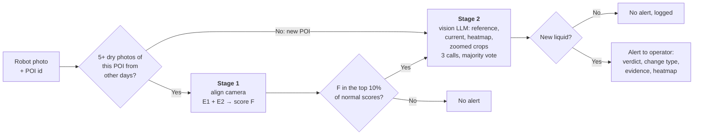

# Westlake Leak Detection — Two-Stage Experiments

Databricks notebooks for finding liquid leaks in plant inspection photos. An ANYbotics robot photographs the same points of interest (POIs) about twice a day, so detection works the way a person would: **first notice that a spot looks different from its own normal history, then decide what the change actually is.**

**Current result (v2, Oct 26, 2026):** on the 156 available labeled images (6 leaks, 150 normal), the v2 pipeline (stage 1 **Model F** + stage 2 **Claude Sonnet 5.5**) catches **6 of 6 leaks with 2 false alarms** (precision 0.75, F1 0.86). With **Gemini 3.8 Flash** as the second check it catches **6 of 6 with 3 false alarms** (F1 0.80).

| System | Leaks caught | False alarms | Precision | F1 |
|---|---|---|---|---|
| Current production model (`leak_suspected`) | 3/6 | 49 | 0.06 | 0.10 |
| v1: Model D + Gemini 3.8 Flash | 5/6 | 0 | 1.00 | 0.91 |
| **v2: Model F + Claude Sonnet 5.5** | **6/6** | **2** | **0.75** | **0.86** |
| v2: Model F + Gemini 3.8 Flash | 6/6 | 3 | 0.67 | 0.80 |

v1 missed the small puddle at POI 422. v2 catches it, at the cost of 2–3 false alarms. See [Caveats](#caveats) before quoting these numbers: there are only 6 leak images (about 4 leak events).

**Contents**
- [How the v2 pipeline works](#how-the-v2-pipeline-works): the decision tree, then each step in detail
- [v2 results](#v2-results): stage 1, stage 2, remaining false alarms, caveats
- [Running the notebooks](#running-the-notebooks)
- [Crowning a champion and registering the model](#crowning-a-champion-and-registering-the-model)
- [Earlier experiments (v1)](#earlier-experiments-v1): what was tried before v2, and why it fell short

> [!IMPORTANT]
> **Update these names before running in Westlake's environment.**
> Every catalog, schema, table, volume, model and endpoint name in these notebooks points at the Databricks FE demo workspace (`stable_classic_wg38i9_catalog`). Westlake's workspace will use **different names**, and the notebooks will fail on the first data cell until you change them.
>
> | What | Variable / location | Notebook(s) | Current (demo) value | Change to |
> |------|---------------------|-------------|----------------------|-----------|
> | MLflow experiment | `EXPERIMENT` (cell *Setup and Data Loading*; widget in the champion notebook) | both | `/Users/jeffrey.pao@databricks.com/Leak Detection - POI Baseline Experiments` | A workspace path you own |
> | Labeled source table | `SPLITS_TABLE` (cell *Setup and Data Loading* / *Settings*) | both | `stable_classic_wg38i9_catalog.westlake_gas_leakage_2.silver_liquid_leak_results_splits` | Westlake labeled results table |
> | Image volume folder | `IMAGE_BASE_PATH` (cell *Setup and Data Loading* / *Settings*) | both | `/Volumes/stable_classic_wg38i9_catalog/westlake_gas_leakage_2/documents/OneDrive_1_10-13-2026/` | Westlake volume + folder |
> | Embedding cache folder | `CACHE` (cell *Setup and Data Loading* / *Settings*) | both | `/Volumes/stable_classic_wg38i9_catalog/westlake_gas_leakage_2/documents/experiments_cache/stage1_v2/` | A writable volume folder |
> | Registered model | `MODEL_NAME` widget | champion | `stable_classic_wg38i9_catalog.westlake_gas_leakage_2.leak_detection_v2` | `<westlake_catalog>.<westlake_schema>.<model_name>` |
> | LLM serving endpoints | `LLMS` widget | v2 | `databricks-gemini-3-8-flash`, `databricks-claude-sonnet-5-5` | Endpoints available in Westlake's workspace |
>
> The source table must also have the columns listed in [Input data](#input-data).

## Files

| File | What it is |
|------|------------|
| `notebooks/leak_detection_v2.py` | **The v2 pipeline in one notebook.** Stage 1 runs camera alignment, E1 (same-spot comparison), E2 (new dark patch) and ensemble F, plus the v1 baselines recomputed for comparison. Stage 2 then runs LLM verification of F's alerts with zoomed, camera-aligned hotspot crops and a 3-call majority vote. |
| `notebooks/register_champion.py` | **Crown a champion.** Ranks every stage 2 configuration logged to MLflow, packages the winner as an MLflow model that runs the full decision tree on new photos, registers it in Unity Catalog and moves the `Champion` alias if it beats the current one. |

These are exports of the workspace notebooks `/Users/jeffrey.pao@databricks.com/Leak Detection v2 - Change Detection + LLM Verification` and `.../Leak Detection - Register Champion`. Both use the same MLflow experiment.

# How the v2 pipeline works

## The decision tree

Every robot photo goes through the same steps:



Stage 1 is plain Python with no AI judgment. It only asks *"is this spot different from its usual self?"* and is tuned to miss nothing. Stage 2 is the only step that uses an LLM. It asks *"is that difference new liquid, or something else?"* and can only remove alerts, never add them. So stage 2's recall is capped by stage 1's.

## Step 0: pick the comparison photos

For a new photo, the reference set is every photo of the **same POI**, taken on a **different day**, that a human labeled as **no leak**.

- Photos from the same day are excluded. Three of the six leak photos are the same puddle at POI 412 photographed within a few hours, and they must never vouch for each other.
- If a POI has **fewer than 5** such photos (POIs 358, 398, 399 and 400 in this data), there is no history to compare against. Those photos skip stage 1 and go straight to stage 2, where the LLM judges the photo on its own. v1 handled these by comparing against *all* POIs, which flagged them by accident rather than by design.

## Step 1: line up the camera

The robot never stops in exactly the same place, so photos of the same spot are shifted. Measured shifts at 960×540: **median 12 px, 90th percentile 24 px, max 49 px** (roughly 4× that in the 4K originals). Without alignment, every edge in the frame looks like a change.

Alignment is a short NumPy function (`phase_shift`), with no LLM and no special library:

1. Downscale both photos to 960×540 grayscale lightness (CIE L\*).
2. Apply a Hann window so the photo borders don't count as features.
3. **Phase correlation:** take both 2-D FFTs, compute the normalized cross-power spectrum, and inverse-FFT it. A pure shift between the photos becomes a single sharp peak, and the peak's position is the shift `(dy, dx)`.
4. Repeat for every ordered pair of photos of the same POI (2,480 pairs, about 20 ms each).

A synthetic test (shift a photo by a known `(7, −12)` and recover it) runs on every notebook run to check the sign convention.

Phase correlation only corrects **translation**. Small rotation, tilt or zoom changes are absorbed by tolerance built into E1 (a ±2-patch search window) and E2 (a 5×5 "darkest nearby pixel" rule), and by per-location normalization (step 2c). A full perspective correction (for example, OpenCV ORB/SIFT keypoints + RANSAC homography) is a possible upgrade if larger viewpoint changes show up.

## Step 2: E1, same-spot comparison ("does this spot look different from its usual self?")

E1 is an aligned, location-normalized version of PatchCore.

**a. Describe every small square of the photo.** DINOv2-small (a pretrained, self-supervised vision transformer from Meta, not fine-tuned) turns each 14×14-pixel patch into a 384-number descriptor. The photo is resized to 896×1596 and processed as **2×2 tiles of 448 px**, giving a **64×114 patch grid**, twice the resolution of v1. A puddle that covered about 5 patches in v1 now covers about 20.

**b. Compare each patch only with the same location.** For patch *(r, c)* in the current photo, find its nearest neighbor among the reference photos' patches **within ±2 patches of the aligned location** *(r + dy, c + dx)*. Distance is Euclidean distance between the normalized descriptors. Taking the minimum over all reference photos gives a **distance map**: how unlike any dry photo each part of the current photo is.

v1 (PatchCore-lite) let a patch match *any* patch anywhere in the reference bank, so a wet floor patch could find a close match in some other dark region of the scene.

**c. Normalize each location by how much it normally varies.** Some places differ every day even when dry: windows, lights, reflections, moving shadows. For each reference photo, compute its own distance map against the *other* reference photos (leave one out, other days only). Then, at every location:

- `mu` = median of those leave-one-out distances
- `sd` = 1.4826 × MAD, smoothed with a Gaussian (σ = 1 patch) and floored at half its median
- **z = (distance − mu) / sd**

A large z means "unusual *for this spot*".

**d. Score.** The E1 score is the **mean of the top 0.1% of z values** (about 7 patches). v1 averaged the top 1% (about 18), which let ordinary background patches outvote a small puddle.

## Step 3: E2, new dark patch ("is part of the floor newly darker?")

Wet concrete is darker than dry concrete. E2 checks that directly, at pixel level:

1. Shift each reference photo's L\* lightness image (960×540) by its alignment, and take the per-pixel **median** and **MAD** across the references.
2. Remove the global lighting change: subtract the median difference between the current photo and the reference median over the whole frame.
3. Compare each pixel with the **darkest reference pixel in its 5×5 neighborhood**, so a slightly shifted dark edge (a pipe, a shadow) isn't counted as darker.
4. A pixel is "newly dark" if it is at least **8 L\* units darker** *and* at least **3 robust SDs** of that pixel's day-to-day variation (noise floor 2 L\*).
5. Clean up specks with a binary opening (2 iterations). The E2 score is the **area of the largest connected dark blob**, as a fraction of the frame.

## Step 4: combine into F

E1 and E2 measure different things (texture/appearance vs. darkening) and make different mistakes. **F = average of the percentile ranks of E1 and E2.** A photo needs to look unusual to both to rank highly.

## Step 5: decide what goes to stage 2

The alert threshold is the **90th percentile of F over normal (no-leak) photos only** (the "10% budget"). Leak labels are never used to set it. In this data, that sends **21 of 156 photos** to stage 2, including all 6 leaks. A 20% budget (36 photos) gave the same final result at about 70% more LLM calls.

## Step 6: build what the LLM sees

For each stage 2 candidate:

| Image | What it is |
|---|---|
| 1. Reference | The dry photo of the same POI from another day that is most similar overall (DINOv2 CLS embedding cosine similarity) |
| 2. Current | The photo that triggered the alert |
| 3. Heatmap | The current photo with the E1 z-map overlaid (red/yellow = most changed) |
| 4–7. Zoomed pairs | Up to two **reference/current crop pairs** (1280×720 from the 4K originals, camera-aligned with the step 1 shift), centered on the E1 peak and on the largest E2 dark blob |

All images are downscaled to at most 1024 px wide and sent as JPEG.

The zoomed pairs matter for small leaks. For the POI 422 puddle, both LLMs cited "Zoom 2" as where they saw it. For POIs with no history, the LLM gets only the current photo and a "new inspection point, judge it on its own" prompt.

## Step 7: ask the LLM, three times

The prompt lists liquid-leak indicators that must be **new compared with the reference**:
- a wet or glossy patch
- pooling, drips or a flow path
- a sharp wet/dry boundary
- wetness below a flange or valve
- small puddles, which still count

It also lists common false-alarm causes:
- new or moved objects
- lighting, reflections and shadows
- camera angle
- old stains or markings also visible in the reference
- dirt and footprints

The model must answer with JSON: `leak`, `change_type`, `confidence`, `evidence`. The exact prompts are logged to MLflow as `prompts.json`.

**Why three calls with the same prompt:** LLM outputs aren't deterministic (the endpoint's default sampling is used), so the same request can flip on a borderline image. The candidate's verdict is the **majority of 3 identical calls**, and the agreement rate is logged per image. The pipeline was run twice, on Oct 26 and Oct 27, with identical stage 1 results:
- **Sonnet** was steady: every single call caught 6/6, with 2 false alarms at 10%.
- **Gemini** varied more. In the second run, one single call missed a leak (per-call recall 5–6 of 6) and per-call false alarms ranged 2–4. **The 3-call vote still kept all 6 leaks.**

So voting both stabilizes the false-alarm count and protects recall on borderline calls. **Fail-safe:** if a call errors after retries, it counts as a "leak" vote, so an outage never silently drops an alert.

Calls go through Databricks Foundation Model APIs with the OpenAI-compatible client (`/serving-endpoints`), 8 in parallel.

## Step 8: output

A confirmed alert carries the majority verdict, `change_type`, `confidence`, a one-line `evidence` string (for example *"new dark glossy puddle near the red pipe, absent in the reference"*) and the heatmap, ready for operator review.

## How it was tested

Same strict protocol as v1:
- all 156 labeled photos with an image file (6 leaks, 150 normal, 13 POIs, 12 days)
- **leave-one-day-out** (a photo is scored only against photos from other days)
- thresholds from normal-photo percentiles only
- leak labels used only to grade the final result

# v2 results

## Stage 1 v2 (Oct 26, 2026)

| Model | ROC-AUC | PR-AUC | FP to catch 6/6 | Caught @10% (15 FP) | Caught @20% (30 FP) | Leak ranks (of 156) |
|---|---|---|---|---|---|---|
| D (v1 champion, recomputed) | 0.840 | 0.180 | 88 | 4/6 | 5/6 | 8, 9, 15, 16, 23, 94 |
| E1-448 (aligned, v1 resolution) | 0.816 | 0.138 | 53 | 1/6 | 4/6 | 3, 18, 22, 29, 56, 59 |
| E1-896 raw (no per-location normalization) | 0.896 | 0.192 | 33 | 4/6 | 5/6 | 3, 15, 18, 19, 21, 39 |
| E1-896 | 0.916 | 0.213 | 19 | 4/6 | 6/6 | 3, 13, 16, 18, 22, 25 |
| E2 | 0.929 | 0.239 | 16 | 4/6 | 6/6 | 3, 12, 13, 15, 20, 22 |
| **F. E1-896 + E2** | **0.955** | **0.307** | **9** | **6/6** | **6/6** | **3, 9, 11, 12, 13, 14** |
| G. B1 + C2 + E1-896 + E2 | 0.932 | 0.296 | 34 | 5/6 | 5/6 | 3, 7, 8, 12, 13, 40 |

- **The POI 422 leak moved from rank 94 (D) to rank 13 (F).** In the heatmaps, both E1 and E2 peak on the puddle itself.
- **Each design choice helps.** The ablations show that alignment alone at v1 resolution (E1-448) is not enough, 2× resolution helps, and per-location normalization helps further (E1-896 raw vs. E1-896).
- **E1 and E2 are complementary.** Each catches 6/6 on its own at the 20% budget, and they rank different photos highly, which is why F beats both.
- **Adding the v1 models back in (G) makes it worse.** Their whole-image statistics pull the POI 422 leak back down to rank 40.

## Stage 2 v2 (Oct 26, 2026)

| System | Budget | Leaks caught | False alarms | Precision | F1 | LLM calls | p50 latency |
|---|---|---|---|---|---|---|---|
| Stage 1 only (F) | 10% | 6/6 | 15 | 0.29 | 0.44 | 0 | — |
| Stage 1 only (F) | 20% | 6/6 | 30 | 0.17 | 0.29 | 0 | — |
| **F + Claude Sonnet 5.5** | **10%** | **6/6** | **2** | **0.75** | **0.86** | 63 (21 × 3) | 3.1 s |
| F + Claude Sonnet 5.5 | 20% | 6/6 | 2 | 0.75 | 0.86 | 108 (36 × 3) | 3.1 s |
| F + Gemini 3.8 Flash | 10% | 6/6 | 3 | 0.67 | 0.80 | 63 (21 × 3) | 2.8 s |
| F + Gemini 3.8 Flash | 20% | 6/6 | 3 | 0.67 | 0.80 | 108 (36 × 3) | 2.8 s |

Latency is per call, measured with 8 calls in parallel.

**Recommended configuration:** F + Claude Sonnet 5.5 at the 10% budget. It ties for 100% recall, has the fewest false alarms, and uses about 40% fewer calls than the 20% budget for the same result. Gemini 3.8 Flash is a close alternative: a 1-alarm gap out of 150 normal photos is within run-to-run noise.

## Remaining false alarms

| Photo | Flagged by | What it is | Likely fix |
|---|---|---|---|
| POI 412, 2026-09-11 | Both LLMs | A **dried residue ring** where the 09-08 puddle had been. The most-similar reference was from before the leak (09-08 04:01), so the stain looked new. | Also send the **most recent** dry photo as a second reference; it would already show the stain. |
| POI 417, 2026-09-08 | Sonnet (both runs); Gemini (Oct 27 run) | A dark area on the floor next to a hose that had been moved | Review with Westlake operators; more labeled history at this spot |
| POI 398 (both runs), POI 400 (Oct 26 run) | Gemini | New POIs with no history, judged from a single photo | Resolves as the robot builds 5+ dry photos of each POI |

## Caveats

- **Very few leaks:** there are only 6 leak photos from about 4 leak events. One photo changes recall by 17 points.
- **Possible design bias:** E1 and E2 were designed after studying the leak v1 missed. The ablations and the fact that E1 and E2 each reach 6/6 independently argue against a lucky fit, but they don't rule it out.
- **The LLM comparison is close:** the Sonnet vs. Gemini comparison rests on a 1-photo difference, and in v1 Gemini was the stronger verifier.
- **Treat these as promising, not final:** confirm them on new labeled robot photos before production.

## MLflow runs (demo workspace)

Experiment: `/Users/jeffrey.pao@databricks.com/Leak Detection - POI Baseline Experiments`

Run IDs from both runs: Oct 27 is the `leak_detection_v2.py` notebook, Oct 26 is the earlier two-notebook version of the same code.

| Run | Oct 27 run ID | Oct 26 run ID |
|---|---|---|
| Summary - Stage 1 v2 aligned experiments | `9453b0646ec942d191c45408d3fb6553` | `83565260569d4f878f13ad18508193ca` |
| v2 F. Ensemble E1-896 + E2 | `01441d53748f4153933726f58728dd9e` | `89840de3ae4141ff85de63f558882746` |
| **Stage 2 v2: F + Claude Sonnet 5.5 [10% budget]** | `34b1a18e5e5c4b5d9e394965f57914a5` | `d909479ea59b46159090fdd3dc11808d` |
| Stage 2 v2: F + Gemini 3.8 Flash [10% budget] | `591ea548a08b4906be4353c7cf78098f` | `c07ab3163d0545d68397e255989fd487` |
| Summary - Stage 2 v2 LLM verification (F) | `8dec5e243153450d8eca7117db0366b0` | `dde458cd8c8e40ffbc67f12a75c58fe4` |

Artifacts:
- The stage 1 summary run logs `summary.json`, `per_leak_ranks.json` and `v2_heatmaps.png` (reference / E1 heatmap / E2 dark blob for every leak and the top false alarms).
- Each stage 2 run logs `candidate_verdicts.json` (votes, agreement, change type, evidence per candidate) and `prompts.json`.

The v2 champion is registered as `stable_classic_wg38i9_catalog.westlake_gas_leakage_2.leak_detection_v2` (v1, alias `Champion`). See [Crowning a champion](#crowning-a-champion-and-registering-the-model).

# Running the notebooks

1. Import the notebooks from `notebooks/` into a Databricks workspace.
2. Update the names in the table at the top of this README.
3. Use serverless or a cluster with internet access, so it can download `facebook/dinov2-small` from Hugging Face. The v2 notebook was run as a serverless job (environment version 4).
4. **v2** (`leak_detection_v2.py`): run all cells. Stage 1 runs first and stage 2 uses its results directly. Widgets:
   - `STAGE1_MODEL`: which stage 1 score sends images to stage 2 (default `F. Ensemble E1-896 + E2`)
   - `LLMS`: comma-separated `Name=endpoint` pairs
   - `REPEATS`: calls per candidate (default 3)

   Runtime:
   - The first run computes features and embeddings for every photo (about 21 minutes on serverless CPU) and caches them in `CACHE`. Later runs reuse the cache when the image list hasn't changed.
   - Stage 2 makes `REPEATS` × candidates calls per LLM (63 at the 10% budget, 108 at 20%), 8 in parallel.
5. **Champion** (`register_champion.py`): run all cells after `leak_detection_v2`. See [the next section](#crowning-a-champion-and-registering-the-model).

# Crowning a champion and registering the model

`register_champion.py` turns the experiment results into a deployable model. Run it after `leak_detection_v2`.

## 1. Leaderboard

It collects every `Stage 2 v2:` run in the MLflow experiment and groups repeated runs of the same configuration (stage 1 model × LLM × budget × votes). It then ranks them with the selection rule from the Westlake deck:

1. **Clear the recall bar in every run.** The `MIN_RECALL` widget defaults to 1.0, meaning catch all 6 leaks.
2. **Fewest false alarms:** the worst run first, then the average.
3. **Lowest cost:** fewest LLM calls.
4. **Lowest latency.**

Leaderboard from the Oct 28, 2026 run (2 evaluation runs per configuration):

| Rank | Configuration | Recall (worst run) | False alarms (worst run) | LLM calls per 156 photos | p50 latency |
|---|---|---|---|---|---|
| **1** | **F + Claude Sonnet 5.5, 10% budget** | **100%** | **2** | **63** | 3.0 s |
| 2 | F + Claude Sonnet 5.5, 20% budget | 100% | 2 | 108 | 2.9 s |
| 3 | F + Gemini 3.8 Flash, 10% budget | 100% | 3 | 63 | 3.0 s |
| 4 | F + Gemini 3.8 Flash, 20% budget | 100% | 3 | 108 | 2.8 s |

## 2. Package the champion

The winner is logged as an MLflow pyfunc (`LeakDetectionV2`) that runs the whole [decision tree](#the-decision-tree) on a new photo:

| | |
|---|---|
| **Input** | `image_path` (str), `poi_id` (int) |
| **Param** | `verify` (bool, default `true`): run the stage 2 LLM check on stage 1 alerts |
| **Output** | `no_history`, `e1_score`, `e2_score`, `stage1_score` (F), `stage1_alert`, `verified`, `leak` (final verdict), `leak_votes`, `n_votes`, `change_type`, `confidence`, `evidence`, `reference_file` |

The model is self-contained (about 1.1 GB):

| Artifact | What it holds |
|---|---|
| `bank/poi_<id>.npz` | For each POI with 5+ dry photos: their DINOv2 patch grids, L\* images, CLS embeddings, and the per-location `mu`/`sd` normalizers for E1 |
| `bank/refs/` | 1920-px JPEGs of the dry photos, used only for the LLM's reference views and zoomed crops |
| `historical.npz` | The evaluation's E1 and E2 score distributions, so F is computed on exactly the same scale |
| `config.json` | Alert threshold (the 90th percentile of normal-photo F), LLM endpoint, votes, crop and E2 settings |
| `dino_model/` | `facebook/dinov2-small` weights, so serving needs no Hugging Face download |

**Checks against the evaluation:**
- The notebook rebuilds F for every evaluation photo from the stored distributions and asserts it matches the logged scores exactly.
- The alert threshold is the same one the evaluation used.

**Production differences:**
- New photos are compared with *all* dry photos of their POI known at registration. Evaluation held out same-day photos.
- POIs without a bank always go to the LLM.
- Re-run the notebook to refresh the bank as more photos are labeled.

LLM calls use `databricks-sdk` (`WorkspaceClient().serving_endpoints.get_open_ai_client()`), so they authenticate with the notebook's, job's or serving endpoint's own credentials. If a call fails after retries, the vote counts as "leak", so alerts fail safe.

## 3. Register and crown

- **Register:** the model is registered to `MODEL_NAME` in Unity Catalog. Each version is tagged with its crown metrics (worst-case recall and false alarms, mean false alarms, LLM calls) and its source runs.
- **Crown:** the `Champion` alias moves to the new version only if it ties or beats the current Champion under the same ranking rule. Set `PROMOTE=false` to register without moving the alias.
- **Default model name:** `leak_detection_v2`. This is a separate model from v1's `leak_detection_model` (Model D), because the inputs and outputs differ.

## 4. Smoke test

The notebook reloads the model through `models:/<MODEL_NAME>@Champion` and scores 12 photos with the LLM check on: all 6 leaks, the two evaluation false alarms, a no-history POI and 3 random dry photos.

On Oct 28, 2026:
- **Leaks:** all 6 were flagged by stage 1 and confirmed by the LLM, each with 3/3 votes.
- **No-history photo (POI 398):** sent to the LLM, which rejected it as an old stain.
- **Runtime:** the whole notebook (leaderboard, reference bank, logging and registration, smoke test) ran in 9 minutes as a serverless job.

The dry photos in this test are part of the reference bank, so their low scores are expected. **This test checks the plumbing, not accuracy.** Accuracy comes from the leave-one-day-out evaluation above.

## Using the champion

```python
import mlflow, pandas as pd
mlflow.set_registry_uri("databricks-uc")
model = mlflow.pyfunc.load_model("models:/stable_classic_wg38i9_catalog.westlake_gas_leakage_2.leak_detection_v2@Champion")
alerts = model.predict(pd.DataFrame({"image_path": ["/Volumes/.../new_photo.jpg"], "poi_id": [422]}),
                       params={"verify": True})
```

# Input data

The source table (`SPLITS_TABLE`) needs these columns:

| Column | Used for |
|--------|----------|
| `filename` | Matched against files in `IMAGE_BASE_PATH` |
| `point_of_interest_id` | POI grouping (cast to `int`) |
| `created_on_date_time` | Day used for leave-one-day-out splits |
| `leaked` | Ground truth (`1.0` = leak) |
| `leak_suspected` | Current production alert (`"Yes"` / other) |

# Earlier experiments (v1)

Before v1, five experiments (Oct 2026) tried to find leaks in single photos with vision LLMs, few-shot prompts, Westlake's own inspection rules and prompt, and hand-built image features with a classifier. The lesson was that **context beats model size**: no model could tell a new leak from a permanent stain in a single photo. That led to v1, the first two-stage design (experiments 6 and 7 in the Westlake deck).

**v1 stage 1** compared each photo to its POI's normal history (Oct 18, 2026, same leave-one-day-out protocol):

| Model | Idea | ROC-AUC | Caught @10% budget (15 FP) |
|---|---|---|---|
| A. Absolute features + logistic regression | 10 floor features, trained on the 6 leaks | 0.374 | 1/6 |
| B1. POI-relative feature anomaly | Robust z-scores of those features vs. the POI's dry photos | 0.799 | 3/6 |
| B2. B1 + logistic regression | B1's comparison, trained on the 6 leaks | 0.310 | 1/6 |
| C1. DINOv2 global kNN | Whole-image embedding distance to the nearest dry photo | 0.646 | 2/6 |
| C2. DINOv2 PatchCore-lite | Patch distance to an *unaligned* bank of dry-photo patches | 0.853 | 3/6 |
| **D. B1 + C2** | Rank average | 0.840 | **4/6** |

**v1 stage 2** sent Model D's alerts (20% budget) to four vision LLMs with a dry reference and a heatmap (Oct 16, 2026):

| Verifier | Leaks caught | False alarms | F1 |
|---|---|---|---|
| **Gemini 3.8 Flash** | **5/6** | **0** | **0.91** |
| Claude Sonnet 5.5 | 4/6 | 0 | 0.80 |
| GPT-6.1 Sol | 4/6 | 1 | 0.73 |
| Claude Opus 4.7 | 3/6 | 2 | 0.55 |

**What v1 taught us**
- Learn "normal", not "leak". With about 4 leak events, every model trained on the leaks (A, B2) did worse than random, while every unsupervised model held up.
- A dry "before" photo is what lets an LLM reject lighting, objects and old stains.
- Stage 2 can only remove alerts. v1's ceiling was the POI 422 puddle that Model D ranked 94th of 156, which [v2 fixes](#how-the-v2-pipeline-works).

The v1 notebooks were removed when v2 replaced them. They are preserved at [commit `7bb0cb7`](https://github.com/paojeffrey/westlake-leak-detection-experiments/tree/7bb0cb7/notebooks):
- `poi_baseline_experiments.py` / `.ipynb`: Models A–D, with saved outputs, plus the Model D pyfunc
- `stage2_llm_verification.py`: the four-LLM comparison

Model D (`leak_detection_model` v3) still holds the `Champion` alias on that older registered model.
